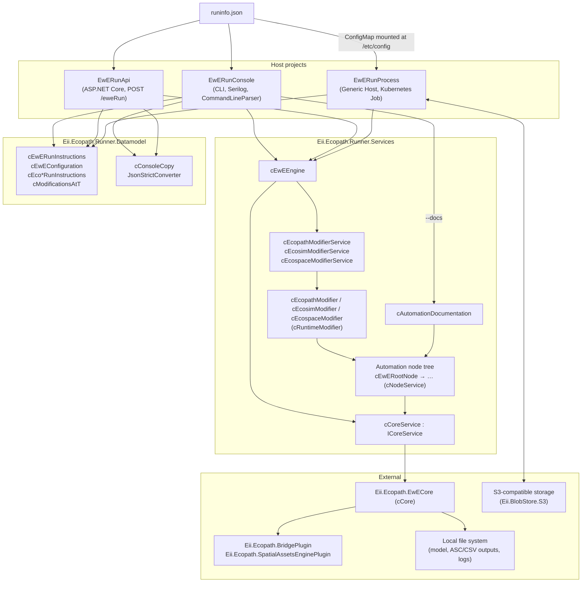
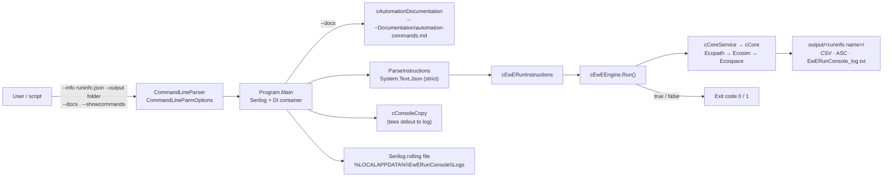
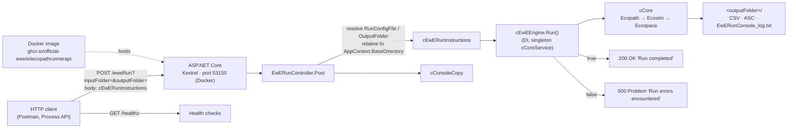
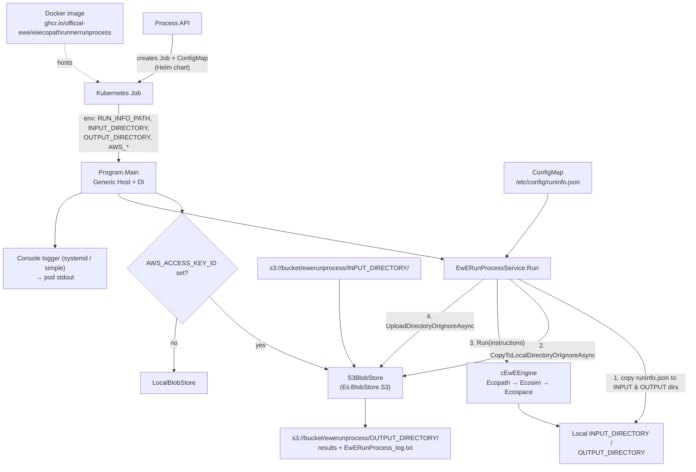
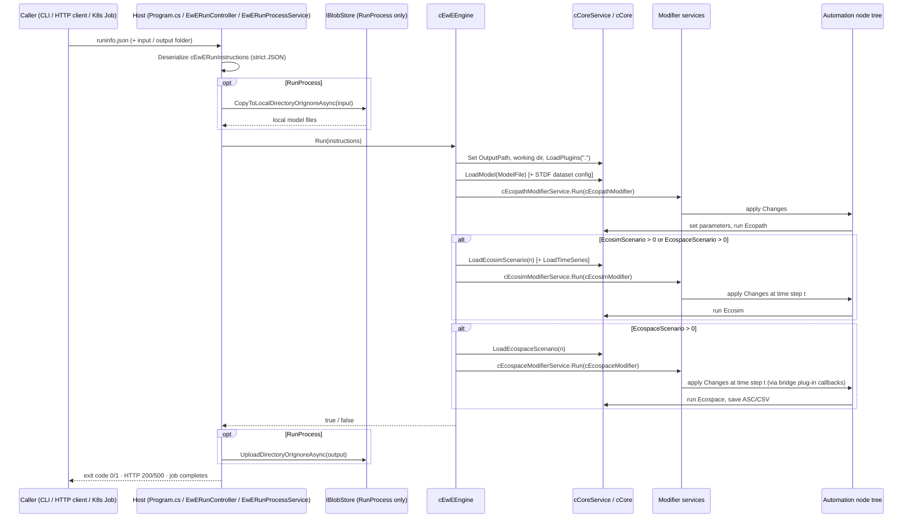
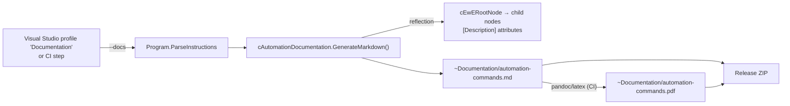
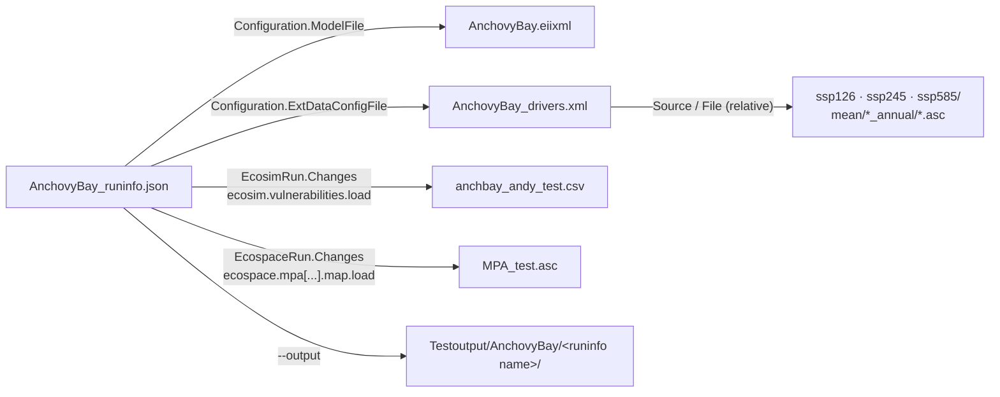

# Eii.Ecopath.Runner — Architecture

## Overview
Eii.Ecopath.Runner is a headless, JSON-driven automation runner for the
[Ecopath with Ecosim (EwE)](https://ecopath.org) marine ecosystem modelling platform. Given a
single JSON "run-info" document, it loads an EwE model and sequentially executes Ecopath,
Ecosim, Ecospace (and Ecotracer) without the EwE desktop GUI, injecting scheduled parameter
changes at specific dates or time steps and writing result files (CSV, ASC maps, logs) to an
output folder. The same engine is exposed in three shapes: a CLI (`EwERunConsole`), a Web API
(`EwERunApi`) and a containerised batch job (`EwERunProcess`) that syncs its input and output
with S3-compatible blob storage.

The system is written in **C# 14** on **.NET 10 (`net10.0`)** and is developed with
**Microsoft Visual Studio 2026**. Linux container images are built with Docker, either from
Visual Studio or through PowerShell scripts.

### Licence
The code is licensed under the **European Union Public Licence v1.2 (EUPL-1.2)**; the full text
is in the `LICENSE` file in the repository root. The licence is also declared in `.zenodo.json`.

### Zenodo
`.zenodo.json` in the repository root holds the metadata Zenodo uses when it archives a GitHub
release and mints a DOI, making every release citable with correct authorship and funding
attribution. It contains:

| Field | Content |
|---|---|
| `title` / `description` | "Ecopath with Ecosim (EwE) automation runner" plus a short abstract |
| `upload_type` | `software` |
| `access_right` / `license` | `open` / `EUPL-1.2` |
| `creators` | Authors with affiliation, ORCID and role (Steenbeek — ProjectManager, Kreeftenberg — Producer, Stock / Pint / Gordó-Vilaseca — Researcher, Claudet — Supervisor) |
| `contributors` | Ecopath International Initiative (ResearchGroup), European Union (Funder) |
| `keywords` | EwE, Ecopath, Ecosim, Ecospace, Ecotracer, ecosystem modelling, model automation, batch processing, reproducible modelling, open source |
| `communities` | `ewe` |
| `related_identifiers` | The GitHub source repository (`isSourceOf`) |

## Responsibilities
- Deserialise and strictly validate a run-info JSON into `cEwERunInstructions`; unknown JSON
  properties are reported as errors (`JsonStrictConverter`).
- Instantiate the EwE core (`cCore`), load plug-ins (bridge plug-in, spatial assets engine
  plug-in), load the model file and the optional spatial-temporal (STDF) data configuration.
- Run Ecopath, then optionally the selected Ecosim scenario / time series and the selected
  Ecospace scenario, honouring configured run years, spin-up years and save options.
- Apply scheduled parameter modifications at runtime through the automation node tree
  (`cEwERootNode` and its children), addressed by dotted command paths such as
  `ecospace.mpa[1].map.load`.
- Write result files and a full console log to the output folder.
- Generate a Markdown reference of all automation commands (`--docs`).
- (RunProcess only) download model inputs from, and upload results to, S3-compatible storage.

### Build outputs

| Binary | Project | Description |
|---|---|---|
| `EwERunConsole.exe` | `Eii.Ecopath.Runner.Console` | CLI. `--info <runinfo.json> --output <folder>` runs a model; `--docs` writes `~Documentation/automation-commands.md`; `--showcommands` prints executed commands. Exit code 0 = success, 1 = failure. Published as a framework-dependent `win-x64` ZIP on GitHub Releases. |
| `EwERunApi.dll` | `Eii.Ecopath.Runner.Api` | ASP.NET Core Web API exposing `POST /eweRun` and `GET /healthz`. Packaged as Docker image `ghcr.io/official-ewe/eiiecopathrunnerapi:latest`. |
| `EwERunProcess.dll` | `Eii.Ecopath.Runner.RunProcess` | Generic-host console app launched as a Kubernetes Job; configured via environment variables and a mounted `runinfo.json`. Packaged as Docker image `ghcr.io/official-ewe/eiiecopathrunnerrunprocess:latest`. |
| `Eii.Ecopath.Runner.Services.dll` | `Eii.Ecopath.Runner.Services` | Class library: engine, modifier services, automation node tree, documentation generator. |
| `Eii.Ecopath.Runner.Datamodel.dll` | `Eii.Ecopath.Runner.Datamodel` | Class library: JSON data contracts and utilities (`cConsoleCopy`, `JsonStrictConverter`). |

## Service architecture
The solution is layered: thin host projects (Console, Api, RunProcess) handle I/O and process
lifetime, while all modelling logic lives in the shared `Eii.Ecopath.Runner.Services` library and
all data contracts in `Eii.Ecopath.Runner.Datamodel`. Each host builds a
`Microsoft.Extensions.DependencyInjection` container that registers `ICoreService`/`cCoreService`
(a singleton wrapper around the EwE `cCore`), the per-model modifier services and `cEwEEngine`,
and then calls `cEwEEngine.Run(instructions)`. `cEwEEngine` orchestrates the fixed pipeline
*configure environment → load model → Ecopath → Ecosim → Ecospace* and stops at the first
failure. Per-model `cRuntimeModifier` subclasses translate the `Changes` schedule (dates →
time steps) into automation commands executed against the node tree, which sets values on EwE
core objects through a plug-in callback bridge. The RunProcess host wraps the engine in an
`IBlobStore` abstraction (`S3BlobStore` or `LocalBlobStore`) so the same run can execute inside a
Kubernetes cluster with inputs and outputs in object storage.

### High-Level Architecture



#### Host: EwERunConsole (`Eii.Ecopath.Runner.Console`)



#### Host: EwERunApi (`Eii.Ecopath.Runner.Api`)



#### Host: EwERunProcess (`Eii.Ecopath.Runner.RunProcess`)



### Message flow



### Key design decisions / trade-offs
- **One engine, three hosts.** All orchestration lives in `cEwEEngine`; hosts only differ in
  how they obtain the instructions and where files live. Trade-off: the engine still assumes
  file-system paths (`RunConfigFile`, `OutputFolder`), so the API and RunProcess hosts have to
  synthesise a `RunConfigFile` path from the model file to make relative paths resolve.
- **Fail-fast boolean pipeline.** Each stage returns `bool` and the pipeline stops at the first
  `false`. Simple and predictable, but detailed failure causes are only in the logs, not in a
  structured result.
- **Strict JSON.** `JsonStrictConverter` rejects unknown properties, catching typos in run-info
  files early at the cost of forward-compatibility of old binaries with newer JSON.
- **Dotted automation commands + reflection.** Runtime modifications are string paths resolved
  against the node tree, allowing new parameters to be exposed without changing the JSON schema;
  `cAutomationDocumentation` reflects over the same tree so documentation never drifts.
- **Singleton `cCoreService`.** The EwE core is not thread-safe, so a single `cCore` is shared
  per process; the API is therefore effectively single-run-at-a-time.
- **Blob store abstraction in RunProcess.** `IBlobStore` falls back to `LocalBlobStore` when no
  `AWS_ACCESS_KEY_ID` is present, allowing identical local and in-cluster execution.
- **`cConsoleCopy` for run logs.** Console output is teed to `EwERunConsole_log.txt` in the
  Console and API hosts; it is deliberately not used in RunProcess because it is unreliable in
  Kubernetes.

## Error handling
- **Console:** `Program.ParseInstructions` validates arguments, output folder, run-info presence
  and JSON parsing. `JsonException` and other exceptions are caught, written to the console
  prefixed with `!`, and `Main` returns exit code `1`. Engine failures (`Run()` returning
  `false`) print `! Run errors encountered` and also yield exit code `1`.
- **API:** Missing `inputFolder`/`outputFolder` query parameters throw `ArgumentException`
  (→ HTTP 400 via the ASP.NET pipeline). An engine failure returns `Problem("Run errors
  encountered")` (HTTP 500); success returns `200 OK`.
- **RunProcess:** Missing environment variables, missing run-info file, JSON errors and a missing
  model file in the blob store throw `InvalidOperationException` / `FileNotFoundException`,
  terminating the process so the Kubernetes Job is marked failed. Engine failures are logged;
  output files are uploaded regardless so the log is available in S3.
- **Engine:** `cEwEEngine` never throws for expected failures; each step logs a warning and
  returns `false`. The only `try/catch` guards setting the working directory.

## Logging
- All components log through `Microsoft.Extensions.Logging.ILogger<T>` injected by DI.
  `EwEUtils.Logging.LoggingContext.LoggerFactory` is set at startup so EwE core components that
  are not DI-constructed can obtain loggers as well.
- **Console:** Serilog with a rolling daily file sink under
  `%LOCALAPPDATA%\EwERunConsole\Logs\log-<date>.txt` at `Verbose` level. In addition the
  console output of a run is teed by `cConsoleCopy` into `<output>\EwERunConsole_log.txt`.
- **API:** Default ASP.NET Core logging configured by `appsettings.json`
  (`Default: Information`, `Microsoft.AspNetCore: Warning`). Run console output is teed into
  `<output>\EwERunConsole_log.txt` via `cConsoleCopy`.
- **RunProcess:** Console logger (`systemd` formatter, simple single-line with timestamps) and
  Debug logger; levels can be overridden by a `Logging` section in `appsettings.json`. All
  environment variables are logged at start-up for diagnostics.

## Create documentation
The reference of all automation commands that can appear in a `Changes[].Modifications`
dictionary is **generated from the code**, never written by hand:

1. Run `EwERunConsole --docs` (locally: the **Documentation** launch profile in Visual Studio; in
   CI: `dotnet run --project Eii.Ecopath.Runner.Console/EwERunConsole.csproj -- --docs`).
   No model file, run-info file or EwE core instance is needed.
2. `Program.ParseInstructions` calls `cAutomationDocumentation.GenerateMarkdown()`
   (`Eii.Ecopath.Runner.Services/Automation/Foundation/cAutomationDocumentation.cs`) and writes
   the result to `~Documentation/automation-commands.md`.
3. `GenerateMarkdown()` uses reflection to walk the automation node tree starting at
   `cEwERootNode`. For every public instance method (including inherited ones up to `cNode`):
   - a method returning a `cNode` subtype becomes a Markdown heading and is recursed into;
   - a single `int` parameter is rendered as `[#]`, a single `string` parameter as `[$]`
     (e.g. `ecosim.effort[$].fill`);
   - any other method becomes a bullet listing its parameters;
   - the text of the `[System.ComponentModel.Description]` attribute on the method (and on its
     parameters) becomes the description — which is why every public automation method must
     carry one;
   - methods marked `[AutomationIgnore]` are skipped, and a visited-set guards against cycles.
4. The release workflow converts the Markdown to PDF with pandoc/xelatex and ships both files in
   the release ZIP under `~Documentation/`.

Because the same node classes are used at runtime to resolve command strings and at build time
to produce the documentation, the documentation can never drift from the commands the engine
actually accepts.



## TestData files
Test data lives in `Eii.Ecopath.Runner.Console/Testdata/` (copied to the output directory on
build) with a smaller copy in `Eii.Ecopath.Runner.Api/Testdata/` and an invalid-JSON case in
`Eii.Ecopath.Runner.Console.Tests/Testdata/`. A run-info JSON is the entry point; every other
file is referenced from it, relative to the JSON's folder.

| Folder / file | Purpose | Referenced from |
|---|---|---|
| `AnchovyBay/AnchovyBay_runinfo.json` | Full Ecopath → Ecosim → Ecospace run (50 years, 10 spin-up years, IBM) with scheduled changes | `AnchovyBay` launch profile, integration tests |
| `AnchovyBay/AnchovyBay_EcopathOnly_runinfo.json` | Ecopath only (`EcosimScenario`/`EcospaceScenario` ≤ 0) | `Anchovy EcopathOnly` profile |
| `AnchovyBay/AnchovyBay_EcosimOnly_runinfo.json` | Ecopath + Ecosim, no Ecospace | `Anchovy EcosimOnly` profile |
| `AnchovyBay/AnchovyBay.eiixml` | The EwE model (Anchovy Bay tutorial model) | `Configuration.ModelFile` |
| `AnchovyBay/AnchovyBay_drivers.xml` | STDF dataset configuration: ASCII-grid environmental drivers (o2, thetao …) per SSP scenario | `Configuration.ExtDataConfigFile` |
| `AnchovyBay/ssp126/`, `ssp245/`, `ssp585/` | Yearly `.asc` driver maps (e.g. `o2_bottom_annual/o2_1993.asc`) | `<Source>` / `<File>` entries in `AnchovyBay_drivers.xml` |
| `AnchovyBay/MPA_test.asc` | MPA layer map loaded mid-run | `EcospaceRun.Changes` → `ecospace.mpa[No shrimpers].map.load` |
| `AnchovyBay/anchbay_andy_test.csv` | Ecosim vulnerability matrix | `EcosimRun.Changes` → `ecosim.vulnerabilities.load` |
| `AnchovyBay/AnchovyBay-Vulnerabilities_01/02.csv` | Alternative vulnerability matrices for experiments | manual edits of the run-info |
| `VLIZ/VLIZ_runinfo.json` + `SBNS_1991_2023_V17_TechnicalReport_ewe.eiixml` | Southern Bight North Sea model (VLIZ), Ecopath + Ecosim only | `VLIZ` profile |
| `Andy/R0001_0000.json` + `anchovy_bay_ecosim_ex.eiixml` | Ecosim-only run with explicit per-fleet monthly effort series (`ecosim.effort[#].set`) | `Andy` profile |
| `example_runinfo.json` | Annotated template for new run-info files | documentation |
| `Api/Testdata/AnchovyBay/*` (`.eiixml`, `AnchovyBay_extdata.xml`, `MPA_test.asc`) | Input set for the `POST /eweRun` sample request | `EwERunApi.http` |
| `Console.Tests/Testdata/AnchovyBay/AnchovyBay_InvalidJson.json` | Malformed JSON to assert the failure path (exit code 1) | `cEwERunConsoleFailureTests` |



## Configuration files

| File | Purpose |
|---|---|
| `<name>_runinfo.json` | The run-info document mapped onto `cEwERunInstructions`. Top-level keys `Configuration`, `EcopathRun`, `EcosimRun`, `EcospaceRun`, `EcotracerRun`. Paths are relative to the JSON file; scenario indices are 1-based, `-1` skips a model. |
| `*_extdata.xml` (optional) | STDF spatial-temporal dataset configuration referenced by `Configuration.ExtDataConfigFile`. |
| `NuGet.config` | Package source mapping: `Eii.*` packages come only from the private `github-Official-EwE` feed, everything else from nuget.org. |
| `Eii.Ecopath.Runner.Api/appsettings*.json` | ASP.NET Core logging and host settings. |
| `*/Properties/launchSettings.json` | Visual Studio launch profiles, including Docker profiles (use `containerRunArguments` for bind mounts). |
| `.runsettings` | Test run settings; can set `EWE_DEBUG_BREAK=1` to attach a debugger to the child `EwERunConsole.exe` during integration tests. |
| `Eii.Ecopath.Runner.Api/EwERunApi.http` | Sample HTTP requests for the API. |
| Environment variables (RunProcess) | `RUN_INFO_PATH`, `INPUT_DIRECTORY`, `OUTPUT_DIRECTORY`, `AWS_BUCKET_NAME`, `AWS_S3_ENDPOINT`, `AWS_DEFAULT_REGION`, `AWS_ACCESS_KEY_ID`, `AWS_SECRET_ACCESS_KEY`, `AWS_SESSION_TOKEN`. |
| `.zenodo.json` | Zenodo release metadata (see above). |
| `.github/copilot-instructions.md` | Coding conventions for AI-assisted development. |

## CI/CD
Workflow `.github/workflows/release.yml` ("Build and Release") runs on every push to `master`
on `ubuntu-latest`:

1. Full-depth checkout and .NET 10 SDK setup.
2. GitVersion 6.4.0 computes the semantic version with `workflow=TrunkBased/preview1` and
   `tag-prefix=v` (patch auto-increments; `+semver: minor|major` in a commit message bumps higher).
3. Registers the private `github-Official-EwE` NuGet feed using `GITHUB_TOKEN` and restores
   `EwERunConsole.csproj`.
4. Runs `dotnet run -- --docs` to generate `~Documentation/automation-commands.md`, then converts
   it to PDF with the `docker://pandoc/latex:edge` action (xelatex).
5. Publishes `EwERunConsole` as framework-dependent `win-x64` with version properties injected,
   copies both documentation files into the output and zips it as
   `EwERunConsole-<semver>.zip`.
6. Creates and pushes tag `v<semver>` (skipped if it exists) and creates a GitHub Release with the
   ZIP attached.

**Docker images** are not built by the workflow but by the per-project scripts
`tools/build-push-docker.ps1` (also callable through the MSBuild target `BuildPushDockerImage`).
Each script builds the multi-stage Dockerfile from the solution root, passing
`DOCKER_BUILD_GITHUB_TOKEN` as `--build-arg GITHUB_TOKEN` for the private feed, and pushes to
GitHub Container Registry:

| Project | Image |
|---|---|
| `Eii.Ecopath.Runner.Api` | `ghcr.io/official-ewe/eiiecopathrunnerapi:latest` (base `mcr.microsoft.com/dotnet/aspnet:10.0`, port 53150) |
| `Eii.Ecopath.Runner.RunProcess` | `ghcr.io/official-ewe/eiiecopathrunnerrunprocess:latest` (base `mcr.microsoft.com/dotnet/runtime:10.0`) |

## Technology stack

| Package | Role |
|---|---|
| `Eii.Ecopath.EwECore` 6.7.x | The EwE simulation engine (`cCore`, Ecopath/Ecosim/Ecospace models) |
| `Eii.Ecopath.BridgePlugin` 1.0.x | Plug-in bridge providing runtime callbacks (e.g. `cEcospaceBridgePlugin`) used to inject changes during a run |
| `Eii.Ecopath.SpatialAssetsEnginePlugin` 1.0.x | Spatial-temporal data (STDF) support for Ecospace |
| `Eii.BlobStore` / `Eii.BlobStore.S3` | `IBlobStore` abstraction with local and S3-compatible implementations (RunProcess) |
| `CommandLineParser` 2.9.1 | CLI argument parsing (Console) |
| `Serilog`, `Serilog.Extensions.Logging`, `Serilog.Sinks.File` | Rolling file logging (Console) |
| `Microsoft.Extensions.Logging` / `Hosting` / `DependencyInjection` | Logging abstraction, generic host and DI container |
| `Microsoft.AspNetCore.OpenApi`, `Microsoft.OpenApi` | OpenAPI document generation (API, development only) |
| `Microsoft.VisualStudio.Azure.Containers.Tools.Targets` | Visual Studio Docker tooling (API, RunProcess) |
| `System.Text.Json` (BCL) | Run-info deserialisation with custom strict converter |
| `xUnit`, `FluentAssertions` 6.6.0, `Moq` 4.18.0 | Test frameworks |

## Project Structure

```
Eii.Ecopath.Runner/
├── .github/
│   ├── copilot-instructions.md
│   └── workflows/release.yml
├── .zenodo.json
├── LICENSE
├── NuGet.config
├── README.md
├── Eii.Ecopath.Runner_architecture.md
├── Launch different models and create the documentation.png
├── EwERunner.sln
├── .runsettings
├── Eii.Ecopath.Runner.Console/          # EwERunConsole.csproj
│   ├── Program.cs                       # Serilog + DI + CLI parsing → cEwEEngine
│   ├── CommandLineParmOptions.cs
│   ├── Properties/launchSettings.json   # Per-model and --docs launch profiles
│   └── Testdata/                        # AnchovyBay/, VLIZ/, Andy/, example_runinfo.json
├── Eii.Ecopath.Runner.Api/              # EwERunApi.csproj
│   ├── Program.cs                       # Minimal ASP.NET Core host
│   ├── Controllers/EwERunController.cs  # POST /eweRun
│   ├── Dockerfile
│   ├── EwERunApi.http
│   └── tools/build-push-docker.ps1
├── Eii.Ecopath.Runner.RunProcess/       # EwERunProcess.csproj
│   ├── Program.cs                       # Generic host, IBlobStore selection
│   ├── EwERunProcessService.cs          # download → run → upload
│   ├── Dockerfile
│   └── tools/build-push-docker.ps1
├── Eii.Ecopath.Runner.Services/
│   ├── Services/cEwEEngine.cs           # Pipeline orchestration
│   ├── Services/…ModifierService.cs     # Per-model run services
│   ├── Runtime/                         # cRuntimeModifier and subclasses
│   └── Automation/                      # cEwERootNode tree, Foundation/cAutomationDocumentation
├── Eii.Ecopath.Runner.Datamodel/
│   ├── RunInstructions/                 # cEwERunInstructions and per-model instruction classes
│   └── Utilities/                       # cConsoleCopy, JsonStrictConverter
├── Eii.Ecopath.Runner.Console.Tests/    # Integration tests (child process)
└── Eii.Ecopath.Runner.Services.Tests/   # Unit tests
```

## Source control
Git, hosted on GitHub at `https://github.com/Official-EwE/Eii.Ecopath.Runner` under the
`Official-EwE` organisation. Trunk-based development on the `master` branch; every push to
`master` produces a versioned release and a `vX.Y.Z` tag created by the workflow. There are no
Git submodules; the EwE engine is consumed as NuGet packages from the private GitHub Packages
feed `github-Official-EwE` (requires a PAT with `read:packages` locally and in Docker builds).

## Testing

### Automated tests
- **`Eii.Ecopath.Runner.Console.Tests`** — xUnit integration tests. `cConsoleRunner` launches
  the built `EwERunConsole.exe` as a separate child process against the AnchovyBay test data and
  asserts on exit code, stdout and stderr (`cEwERunConsoleSuccessTests`,
  `cEwERunConsoleFailureTests`). Set `EWE_DEBUG_BREAK=1` (e.g. via `.runsettings`) to have the
  child process call `Debugger.Launch()`.
- **`Eii.Ecopath.Runner.Services.Tests`** — xUnit unit tests for the Services project only,
  using FluentAssertions and Moq. `ICoreService` and `ILogger` are mocked; EwECore types that
  cannot be proxied (e.g. `cShapeData`) and abstract nodes (e.g. `cFunctionNode`) are exercised
  through minimal test-double subclasses. Tests follow the Arrange / Act / Assert layout.
- Tests are not executed by the release workflow; run them from Visual Studio Test Explorer or
  `dotnet test EwERunner.sln`.

### Manual tests
`EwERunConsole` can be exercised with different command-line arguments without typing them: the
launch profiles in `Eii.Ecopath.Runner.Console/Properties/launchSettings.json` pre-configure
`--i <runinfo> --o <output>` for each test model, plus a `--docs` profile. In Visual Studio set
`Eii.Ecopath.Runner.Console` as the start-up project and pick the profile from the dropdown next
to the **Start** button:


| Profile | Command-line arguments | What it exercises |
|---|---|---|
| `AnchovyBay` | `--i Testdata\AnchovyBay\AnchovyBay_runinfo.json --o Testoutput\AnchovyBay` | Full Ecopath → Ecosim → Ecospace run with STDF drivers and scheduled MPA / vulnerability changes |
| `Anchovy EcopathOnly` | `--i Testdata\AnchovyBay\AnchovyBay_EcopathOnly_runinfo.json --o Testoutput\AnchovyBay` | Ecopath only |
| `Anchovy EcosimOnly` | `--i Testdata\AnchovyBay\AnchovyBay_EcosimOnly_runinfo.json --o Testoutput\AnchovyBay` | Ecopath + Ecosim |
| `VLIZ` | `--i Testdata\VLIZ\VLIZ_runinfo.json --o Testoutput\VLIZ` | Larger real-world model, Ecosim only |
| `Andy` | `--i Testdata\Andy\R0001_0000.json --o Testoutput\Andy` | Ecosim with explicit effort time series via `ecosim.effort[#].set` |
| `Documentation` | `--docs` | Generates `~Documentation/automation-commands.md` and exits |

Outputs appear under `Testoutput\<model>\<runinfo name>\` in the build output directory, together
with `EwERunConsole_log.txt`. Add `--showcommands` to any profile to echo every automation command
as it is executed. Other hosts have their own profiles: the API has a Kestrel and a Docker
profile, and RunProcess has a Docker profile that bind-mounts a local `testconfig/` folder to
`/etc/config` via `containerRunArguments`.

### Manual testing with Postman
Start `EwERunApi` (locally on `http://localhost:5013`, or in Docker on port 53150) and send:

```
POST {{host}}/eweRun?inputFolder=Testdata\AnchovyBay&outputFolder=Testoutput\AnchovyBay
Content-Type: application/json

{ "Configuration": { "ModelFile": "AnchovyBay.eiixml", "EcosimScenario": 1,
  "EcospaceScenario": 1, "RunYears": 50, ... }, "EcospaceRun": { ... } }
```

`inputFolder` and `outputFolder` are resolved relative to the application base directory; the
body is the same run-info JSON used by the CLI. Expect `200 OK` with "Run completed" or
`500` with "Run errors encountered"; results and `EwERunConsole_log.txt` appear in the output
folder. `GET /healthz` verifies liveness. A ready-made request is in
`Eii.Ecopath.Runner.Api/EwERunApi.http`, which can be imported into Postman or executed
directly from Visual Studio.
